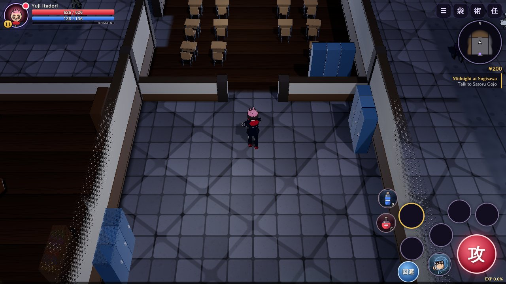
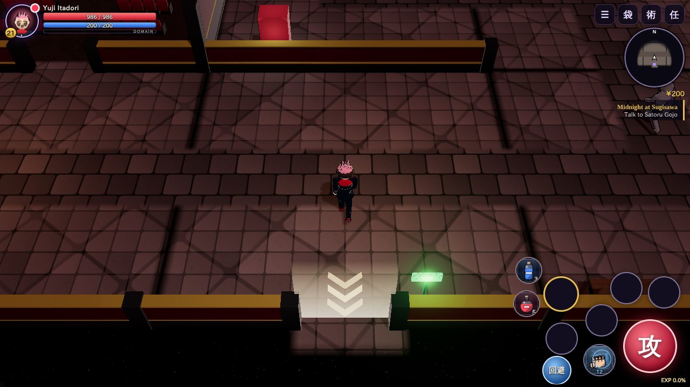
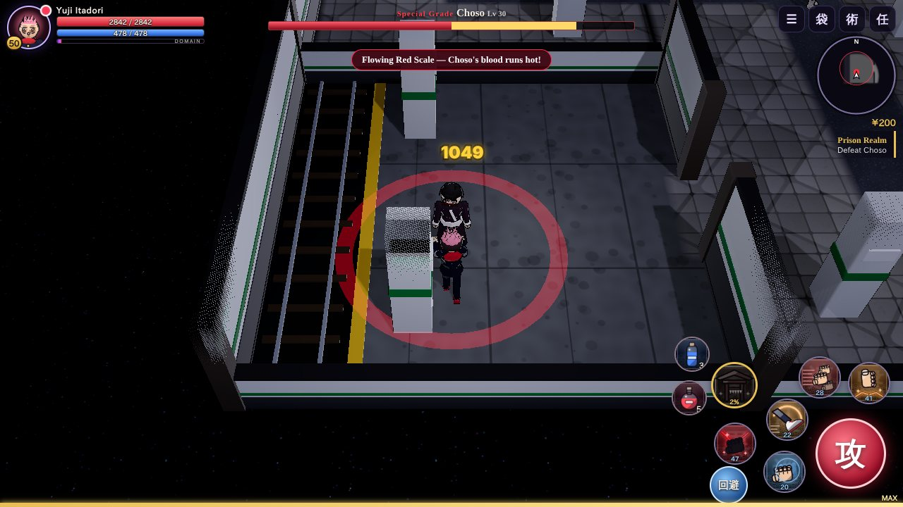
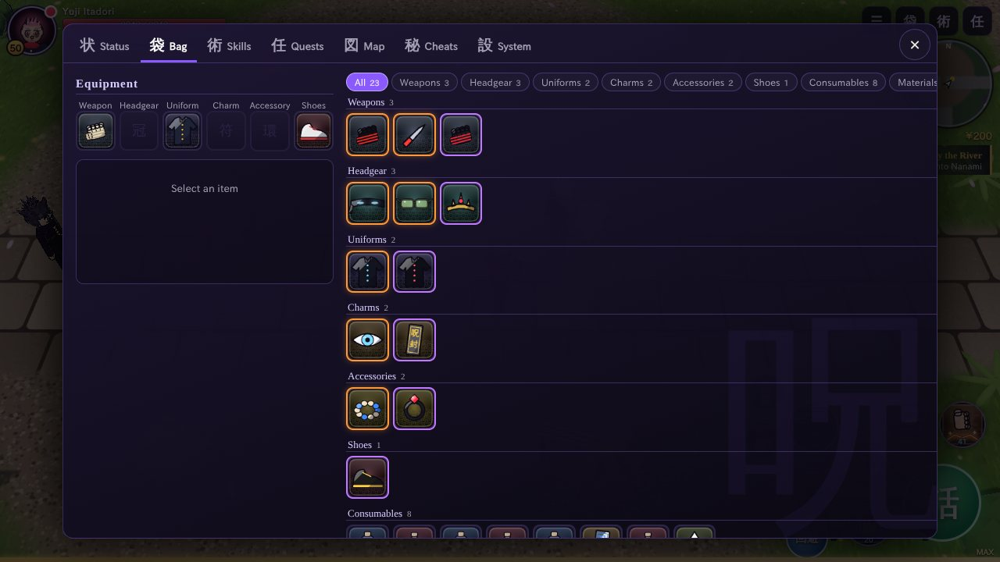

<div align="center">


# Cursed Chronicles

**呪術年代記 — a Zenonia-style action RPG for Android, set in the world of Jujutsu Kaisen**

[](https://github.com/TamanegiNinja25/JJK-Mobile-Game/releases/latest)
[](https://github.com/TamanegiNinja25/JJK-Mobile-Game/actions/workflows/build-apk.yml)


### [⬇ Download CursedChronicles.apk](https://github.com/TamanegiNinja25/JJK-Mobile-Game/releases/latest/download/CursedChronicles.apk)

<sub>Latest release · Android 7.0+ · about 1.3 MB · <a href="https://github.com/TamanegiNinja25/JJK-Mobile-Game/releases">all releases</a></sub>

</div>

Play as Yuji, Megumi or Nobara and fight through the story from the Sugisawa High
rooftop to the Shibuya Incident. Combat is real-time with combos, skills, dodges and
Black Flashes, wrapped in a classic Zenonia-style RPG loop: quests, loot, stat points,
skill trees, gear upgrades and boss fights. Schools, cinemas and stations can be
entered, and their halls are laid out fresh every time you walk in.

Every model, building, texture, icon, portrait, music track and sound effect is
generated in code. The game ships no art or audio files, so the APK is under 2 MB
and runs without an internet connection.

> [!NOTE]
> This is an unofficial, non-commercial fan game. It is not affiliated with or
> endorsed by Gege Akutami, Shueisha or MAPPA. Jujutsu Kaisen and its characters
> belong to their respective owners.

## Contents

- [Screenshots](#screenshots)
- [Download](#download)
- [Features](#features)
- [Controls](#controls)
- [Building from source](#building-from-source)
- [How it works](#how-it-works)
- [Project layout](#project-layout)
- [License](#license)

## Screenshots

<table>
  <tr>
    <td width="50%"><br><sub><b>Choose your sorcerer</b>: three classes, each with its own skill tree</sub></td>
    <td width="50%"><br><sub><b>Tokyo Jujutsu High</b>: the hub, with shops, quests and fast travel</sub></td>
  </tr>
  <tr>
    <td><br><sub><b>Enterable buildings</b>: Sugisawa High's corridors, rebuilt on every visit</sub></td>
    <td><br><sub><b>The Kawasaki cinema</b>, where Mahito's victims were found</sub></td>
  </tr>
  <tr>
    <td><br><sub><b>Megumi</b> fights alongside his shikigami</sub></td>
    <td><br><sub><b>Yuji</b> brawls through the Eishu detention yard</sub></td>
  </tr>
  <tr>
    <td><br><sub><b>Kyoto Goodwill Event</b>: the forest where Hanami hides</sub></td>
    <td><br><sub><b>Story dialogue</b> with portraits, voice blips and choices</sub></td>
  </tr>
  <tr>
    <td><br><sub><b>Boss fights</b> with telegraphed attacks and phases</sub></td>
    <td><br><sub><b>Domain Expansion</b>: sure-hit damage until you break it</sub></td>
  </tr>
  <tr>
    <td><br><sub><b>Domain clash</b>: cast your ultimate inside an enemy domain to shatter it</sub></td>
    <td><br><sub><b>Choso</b> guards the Prison Realm on Shibuya Station's B5F platform</sub></td>
  </tr>
  <tr>
    <td><br><sub><b>Skills</b>: actives, buffs, passives, reactions and an ultimate, with a quick bar</sub></td>
    <td><br><sub><b>Bag</b>: six equipment slots, items grouped by category</sub></td>
  </tr>
</table>

## Download

1. Download [**CursedChronicles.apk**](https://github.com/TamanegiNinja25/JJK-Mobile-Game/releases/latest/download/CursedChronicles.apk) from the
   [latest release](https://github.com/TamanegiNinja25/JJK-Mobile-Game/releases/latest).
   Every successful
   [build](https://github.com/TamanegiNinja25/JJK-Mobile-Game/actions/workflows/build-apk.yml)
   also has the APKs under its **CursedChronicles-apk** artifact.
2. On your phone, allow **Install unknown apps** for your browser or file manager, then
   open the APK.

Requirements: Android 7.0 (API 24) or newer with OpenGL ES 3.0. The game plays in
landscape. If the frame rate stays low, it lowers the graphics quality automatically;
you can also set it under **Settings**.

## Features

### Three sorcerers

| | Style | Signature skills | Ultimate |
|---|---|---|---|
| **Yuji Itadori** | Close-range brawler with the best Black Flash odds | Divergent Fist · Manji Kick · Black Flash · Piercing Blood · Supernova · Dismantle | King of Curses: Malevolent Shrine |
| **Megumi Fushiguro** | Shikigami summoner and swordsman | Divine Dogs · Nue · Max Elephant · Great Serpent · Piercing Ox · Divine Dog: Totality | Domain Expansion: Chimera Shadow Garden |
| **Nobara Kugisaki** | Mid-range nails, hammer and Resonance | Hairpin · Resonance · Straw Doll Curse · Nail Lance · Chain Resonance · Blood Resonance | Resonance: Thousand Nails |

Each class has about twenty techniques of five kinds:

- **Active:** attacks, summons and movement skills on the quick bar.
- **Buff:** timed boosts such as Cursed Energy Surge, Round Deer or Steady Aim.
- **Passive:** always-on bonuses.
- **Reaction:** triggers by itself when you are hit, land a kill or drop to low HP
  (Counter Stance, Loyal Hounds, Final Nail and more).
- **Ultimate:** spends a full domain gauge.

Every level gives 10 stat points (STR, DEX, VIT, CE) and 1 skill point, up to level 50.

### The RPG loop

- **Combat:** combo chains, dodge with invulnerability frames, five skill slots, an
  ultimate and two potion slots.
- **Black Flash:** a ×2.5 critical with hit-stop. It fills your domain gauge and grants
  a short "zone" buff.
- **Loot:** four rarities (Common, Graded, Special Grade, Cursed Tool) with random
  bonus stats. Gear fills six slots: weapon, headgear, uniform, charm, accessory and
  shoes. The bag and the shops group items by category.
- **Infusion:** Yaga's workshop upgrades gear from +1 to +10. Higher levels can fail
  and drop a level.
- **Towns and travel:** Shoko sells potions, Maki runs the armory and Mei Mei trades
  materials. Ijichi drives you between unlocked areas.
- **Saves:** three slots with autosave. Older saves are upgraded automatically.
- **Cheats tab:** god mode, infinite cursed energy, one-hit kills, no cooldowns, extra
  speed, double EXP, all areas unlocked, plus one-tap level-ups, gear, items and quest
  completion. Toggles are saved per slot.

### Enterable buildings

Sugisawa High, the Jujutsu High dorm, Eishu's admin block, the Kawasaki cinema and
Shibuya Station each have a lit doorway. Inside, the floor plan is generated on every
visit: a random network of halls and rooms with a few loops, themed furniture
(classrooms, cells, screening rooms, platforms, tatami bedrooms) and cutaway walls on
the camera side. The story beat for each building sits in the room farthest from the
door. Some rooms hide sealed caches with yen and gear, and the minimap starts dark and
fills in as you explore.

### The story

Five chapters plus an epilogue, with 16 main quests and 14 side quests across seven
areas and five interiors. Key moments follow the anime and manga:

1. **Sugisawa Third High.** Yuji's grandfather's last words, the Occult Research Club
   seniors who broke the seal, and the finger Yuji swallows.
2. **Eishu Juvenile Detention Center.** A rescue in the rain, the Finger Bearer,
   Sukuna's binding vow, and Tadashi Okazaki's name tag for his mother.
3. **Kawasaki.** Nanami, Screen 3 of the cinema, Junpei and Mahito, and movie training
   with Yaga's cursed dolls while Yuji is "dead".
4. **Kyoto Goodwill Event.** Todo asks what your type is, then Hanami invades.
5. **Shibuya Incident.** Veil anchors, the Prison Realm on B5F guarded by Choso, then
   Dagon, Jogo and the King of Curses.
6. **Epilogue.** Mahoraga, who adapts to your damage, and a Soul Resonance rematch with
   Mahito alongside Todo. That fight ends with the man wearing Geto's face.

### Bosses and domains

Ten bosses, each with its own move set, telegraphs, HP phases and summons. Mahito,
Dagon, Jogo and Sukuna expand their **domains**: everyone inside takes sure-hit damage.
Survive it, or cast your ultimate inside it to start a **domain clash** and break it.
A boss expanding its domain also charges your gauge.

### Look and sound

- Low-poly, faceted models: every surface is lit as flat planes on a 4-band cel ramp,
  while faces stay smooth. Ink outlines, rim light, glowing cursed energy and bloom.
- Characters carry their trademarks: Gojo's blindfold, Nanami's goggles and
  leopard-print tie, Maki's glasses and polearm, Inumaki's zipped collar, Todo's scar,
  Choso's blood stripe.
- Day and night lighting, dynamic lights and weather: rain, sakura, falling leaves, ash
  and fireflies.
- Trees, roofs and walls fade out when they would hide your character.
- Synthesized sound for every action, timed to the animation: footsteps land on each
  foot plant and change with the surface, swings sound on the wind-up and hits on the
  contact frame, for players, curses, shikigami and bosses alike.
- A music theme for each area and for bosses, layered over ambience such as rain,
  crickets, city noise and wind.

## Controls

**Touch:** a floating joystick on the left, and action buttons on the right for
attack, five skills, ultimate, dodge, two potions and talk. Menus are at the top right;
the Cheats tab is in the main menu. Walk into a lit doorway to enter or leave a building.

**Keyboard** (in a browser, or on a phone with a keyboard):

| Key | Action |
|---|---|
| <kbd>W</kbd><kbd>A</kbd><kbd>S</kbd><kbd>D</kbd> / arrows | Move |
| <kbd>J</kbd> / <kbd>Space</kbd> | Attack (combo) |
| <kbd>1</kbd>–<kbd>5</kbd> | Skills |
| <kbd>R</kbd> | Ultimate |
| <kbd>Shift</kbd> | Dodge |
| <kbd>Q</kbd> / <kbd>E</kbd> | HP / CE potion |
| <kbd>F</kbd> / <kbd>Enter</kbd> | Talk, advance dialogue |
| <kbd>1</kbd>–<kbd>9</kbd> in dialogue | Pick a choice |
| <kbd>I</kbd> <kbd>K</kbd> <kbd>L</kbd> <kbd>M</kbd> <kbd>C</kbd> | Bag, skills, quests, map, status |
| <kbd>Esc</kbd> | Close menu / open the system menu |

On Android, **Back** closes menus. Press it twice quickly to quit.

## Building from source

You need Node.js 22 to build the game, and JDK 17 plus the Android SDK
(compileSdk 35) for the APK.

```bash
git clone https://github.com/TamanegiNinja25/JJK-Mobile-Game.git
cd JJK-Mobile-Game/web
npm ci
npm run typecheck
npm run build             # bundles the game into android/app/src/main/assets/www/

cd ../android
./gradlew assembleDebug   # APK lands in app/build/outputs/apk/debug/
```

The built bundle is committed, so Android Studio can open `android/` and run the app
without Node.

To work on the game in a desktop browser, run `npm run serve` in `web/` and open
<http://localhost:8080>. It rebuilds on save, with source maps.

**CI:** [`.github/workflows/build-apk.yml`](.github/workflows/build-apk.yml)
type-checks, bundles and builds debug and release APKs on every push and pull request.
To ship a version, publish a release on GitHub (or run **Build APK** by hand from the
Actions tab with a tag such as `v1.1.0`); the workflow builds the APK and attaches it
to that release. Pushing a `v*` tag does the same. The release build is signed with
the debug key so it can be sideloaded; use your own keystore before distributing it
elsewhere.

## How it works

The game is a TypeScript and [three.js](https://threejs.org) app, bundled by esbuild
into one script. A small Java app shows it in a full-screen `WebView`. It serves the
files from the APK's assets over a virtual `https://appassets.androidplatform.net`
origin, so WebGL, Web Audio and `localStorage` saves behave as in a normal browser,
offline. There are no third-party Android dependencies.

**Procedural art**
- Characters and curses are built from primitives by `RigBuilder`. Each becomes one
  rigid-skinned mesh with a shared skeleton, animated by a procedural animator with
  attack, cast and reaction poses for each move.
- Materials use a 4-band toon ramp and per-vertex glow, with inverted-hull outlines
  and a shared rim light. Parts are built with few segments and lit with per-face
  normals for the low-poly look; a copy of the smooth normal drives the outline hull so
  ink lines stay unbroken. A dither shader hides scenery standing between the camera
  and your character.
- Interiors come from `src/world/interiors.ts`: a seeded spanning tree over a grid of
  rooms, extra links for loops, breadth-first distance to pick the story room, then
  walls, doors, furniture, lights and spawners per cell.
- Buildings and props are merged or instanced meshes. Terrain blends four canvas
  textures with a painted splat map. Skill icons, item icons and portraits are drawn
  at runtime.

**Procedural audio:** sound effects are synthesized with Web Audio (noise bursts, FM
and a Karplus-Strong koto). Each area's music is a step sequencer that composes
phrases on the fly, layered over ambience loops and a convolution reverb.

**Performance:** there are three quality tiers that set resolution, shadows and bloom,
and the game drops a tier automatically when the frame rate stays low. A fixed pool
of four point lights avoids shader recompiles, and particles are pooled on the GPU.

## Project layout

```
web/                    the game (TypeScript + three.js)
  src/core/             input, math, noise
  src/render/           renderer, toon shaders, rigs, models, effects, weather, textures
  src/audio/            synthesized SFX, music sequencer, ambience
  src/rpg/              stats, classes, skills, items, enemies, player state
  src/world/            maps, map builder, collision, world simulation
  src/entities/         player, enemies, bosses, summons, projectiles, NPCs
  src/ui/               HUD, menus, dialogue, icons, portraits
  src/data/story.ts     quests and dialogue
  static/               index.html and the UI stylesheet
android/                WebView host app (Java)
docs/                   icon and screenshots for this README
.github/workflows/      APK build and release
```

## License

The game's source code is released into the public domain under the
[Unlicense](LICENSE). Jujutsu Kaisen, its characters and its story belong to Gege
Akutami, Shueisha and MAPPA. That license covers only the original code in this
repository, not the franchise.
